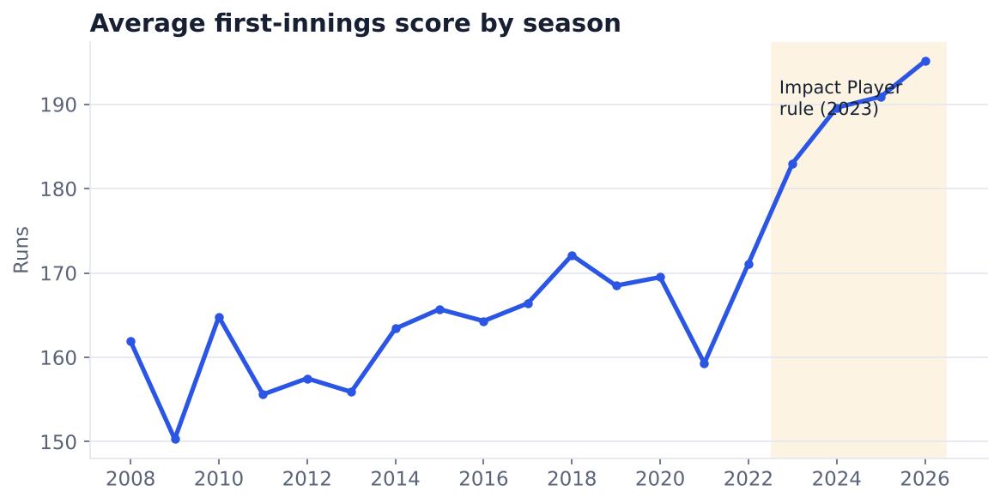
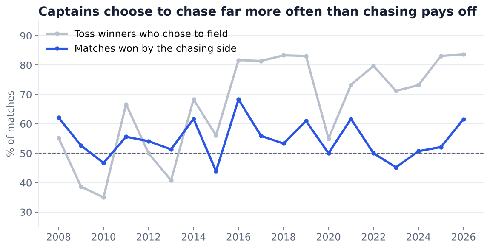
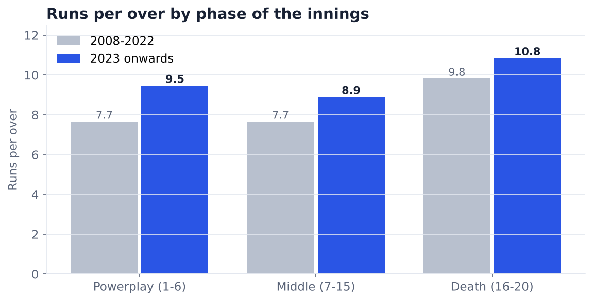
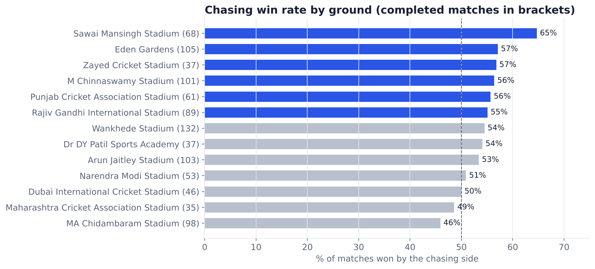
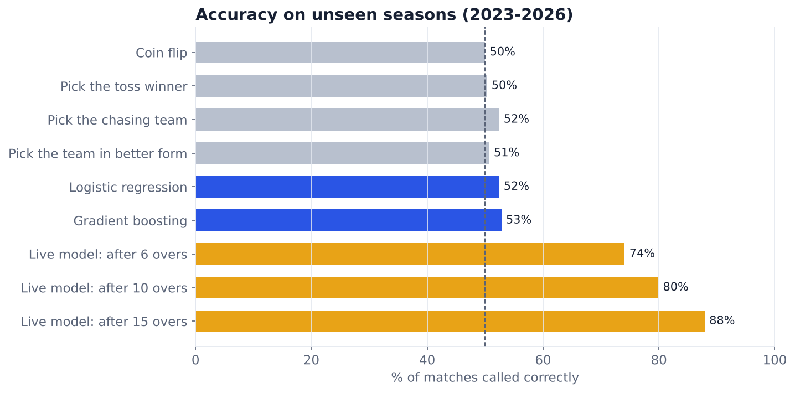
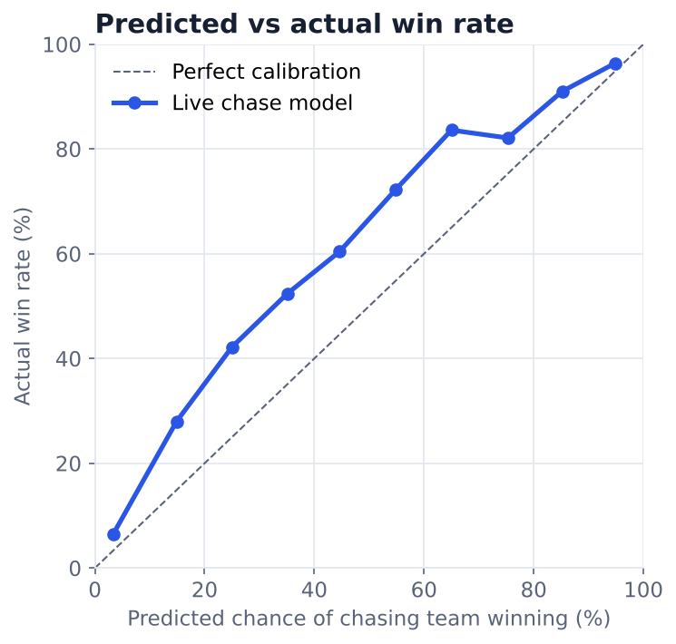

# IPL Match Analytics, 2008–2026

What actually decides a T20 match? An analysis of all 1,243 Indian Premier League matches from 2008 to 2026, ball by ball, using Python and SQL, with two prediction models tested on seasons they never saw.

**Interactive dashboard and live win-probability calculator:** https://aman-portfolio-rouge-nine.vercel.app/projects/ipl

## Key findings

1. **The toss barely matters.** Toss winners won 51.4% of completed matches, close to a coin flip. Teams that won the toss and chose to bat won only 45.4%.
2. **Captains over-trust chasing.** Since 2016 more than three-quarters of toss winners (77%) chose to field first, but chasing sides won 54.5% of matches overall. That is an edge, but a much smaller one than captains' choices suggest.
3. **The Impact Player rule changed the game.** The average first-innings score rose from 171 in 2022 to 195 in 2026, and more than half of 2026 first innings passed 200. Powerplay scoring jumped from 7.7 to 9.5 runs per over.
4. **Some grounds favour chasing.** Sawai Mansingh Stadium in Jaipur (65% chasing wins across 68 matches) and Eden Gardens (57%) lean towards the chasing side, while Pune's MCA Stadium is close to even.
5. **Pre-match predictions are close to guessing.** Using only what is known before the first ball (toss, recent form, head-to-head, ground), the best model called 52–53% of 2023–2026 matches correctly. T20 cricket has a lot of randomness, and the honest result is that pre-match information gives only a small edge.
6. **Live predictions work well.** During a chase, a model using runs needed, balls left and wickets in hand called the winner correctly 74% of the time after 6 overs, 80% after 10 and 88% after 15.
7. **Models need retraining when the game changes.** Trained only on 2008–2022, the live model underrated chasing sides in the high-scoring Impact Player era. Retraining on seasons to 2024 with an era flag raised accuracy on 2025–2026 from 79% to 82% and lowered log loss from 0.432 to 0.387.











## How it works

| Step | File | What it does |
|---|---|---|
| 1. Build tidy tables | `src/build_dataset.py` | Reads 1,243 Cricsheet match files (JSON), standardises renamed teams and grounds, and writes three tables: `matches`, `phases` (runs and wickets per innings phase) and `chase_states` (the state of every chase at the end of each over). |
| 2. Analyse with SQL | `sql/*.sql`, `src/run_sql.py` | Loads the tables into SQLite and answers six questions: toss impact, chasing by season, scoring trends, phase run rates, ground effects and franchise records. |
| 3. Model | `src/model.py` | Pre-match model (logistic regression and gradient boosting against four simple baselines) and live chase model. Trained on 2008–2022, tested on 2023–2026. |
| 4. Charts | `src/charts.py` | Draws the charts in `charts/`. |
| 5. Dashboard data | `src/export_dashboard.py` | Bundles results and the final model's coefficients into `outputs/dashboard.json` for the website. |

### Avoiding data leakage

- Every pre-match feature (form, career win rate, head-to-head, ground chasing rate) is calculated only from matches played **before** the match being predicted.
- Models are tested on later seasons than they are trained on, the way they would be used in real life.
- Every model is compared with simple baselines: a coin flip, picking the toss winner, picking the chasing team and picking the team in better form.
- Rain-affected (D/L) matches and no-results are left out of the scoring and live-model data.



## Run it yourself

```bash
git clone https://github.com/ritesh-ojha/IPL-DATASET
pip install -r requirements.txt
python src/build_dataset.py IPL-DATASET
python src/run_sql.py
python src/model.py
python src/charts.py
python src/export_dashboard.py
```

## Tools

Python (pandas, NumPy, scikit-learn, Matplotlib), SQL (SQLite), Next.js for the dashboard.

## Data

Ball-by-ball data from [Cricsheet](https://cricsheet.org), via the [IPL-DATASET](https://github.com/ritesh-ojha/IPL-DATASET) repository (MIT licence). Covers every IPL match from 18 April 2008 to 31 May 2026.
