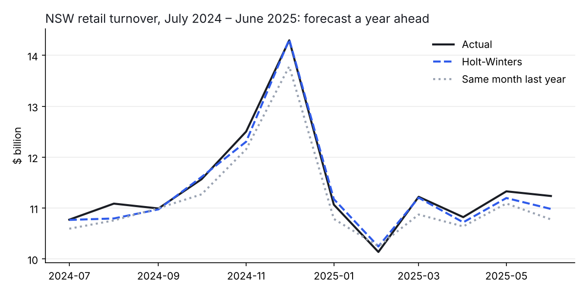
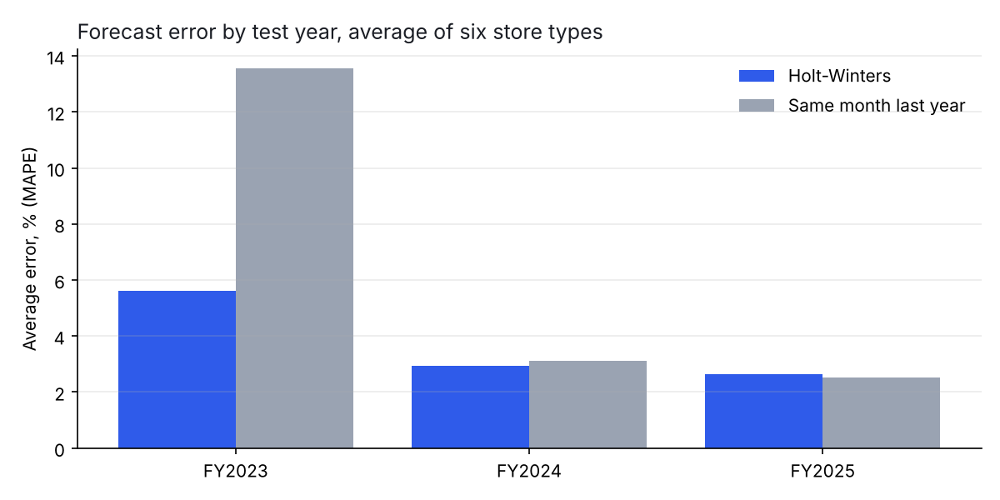

# NSW Retail Sales Forecast, 2010–2025

Can NSW retail sales be forecast a year ahead, and which kinds of shops are hardest to predict? This project takes the ABS monthly retail turnover series for New South Wales by store type, asks three questions in SQL, and backtests a Holt-Winters forecasting model against a simple "same month last year" baseline over three financial years.

## Key findings

1. **Growth has slowed to a crawl.** NSW shops turned over $137.0 billion in 2024–25, up 2.3% on the year before, after an 11.0% jump in 2022–23 as spending bounced back from lockdowns.
2. **Christmas matters most to department stores.** In 2024, December turnover was 26.5% above an average month for retail overall, 70.9% for department stores and 47.3% for clothing, but only 14.0% for cafes and takeaway.
3. **Lockdown moved spending, it did not stop it.** In August 2021, during Sydney's Delta lockdown, department stores took 52.7% less than in August 2019 and cafes 44.1% less, while food retailing rose 17.5%. Total retail fell only 3.8%.
4. **The model beats the baseline overall.** Across 2022–23, 2023–24 and 2024–25, Holt-Winters forecasts a year ahead were out by 3.73% on an average month for a typical store type, against 6.41% for "same month last year". For total retail the error was 1.41% against 4.49%. It won in 5 of the 6 store types; "other retailing" was the exception.
5. **A simple baseline is hard to beat in a normal year.** Most of the model's advantage came from 2022–23, when copying the lockdown-hit year before was badly wrong (13.56% error against 5.62%). In 2024–25 the two were almost level (2.64% against 2.52%). The model earns its keep when last year was unusual.





## How it works

| Step | File | What it does |
|---|---|---|
| 1. Fetch | `src/fetch_data.py` | Downloads monthly NSW retail turnover (current prices, original series) for total retail and six store types from the ABS Data API. Writes `data/retail.csv`. |
| 2. Analyse with SQL | `sql/*.sql`, `src/run_sql.py` | Loads the data into SQLite and answers three questions: yearly turnover and growth (window functions), the December peak by store type, and the change during the 2021 lockdown. |
| 3. Forecast | `src/forecast.py` | For each of the last three financial years, trains on months before that year only (from January 2010) and forecasts 12 months ahead. Compares Holt-Winters (damped trend, multiplicative yearly seasonality) with the same-month-last-year baseline using mean absolute percentage error. |
| 4. Charts | `src/charts.py` | Draws the charts in `charts/`. |
| 5. Tests | `tests/` | Checks the error measure, that test months always come after training months, the baseline, and that the model recovers a clean seasonal pattern. |

### Testing it fairly

- Every forecast is made with data that would have been available at the time: no test month is ever in the training data.
- Three rolling test years, not one, so a single lucky or unlucky year does not decide the result.
- The model is always compared with a baseline a shop manager could work out by hand.

### Limits

Turnover is in current prices, so part of the growth is inflation. The ABS series used here ends in June 2025. Holt-Winters only learns from the series' own past; it cannot see interest rates, prices or events such as lockdowns coming.

## Run it yourself

```bash
pip install -r requirements.txt
python src/fetch_data.py
python src/run_sql.py
python src/forecast.py
python src/charts.py
python -m pytest tests
```

## Data

Australian Bureau of Statistics, Retail Trade, Australia: retail turnover by industry group, New South Wales, current prices, original series (CC BY 4.0), from the ABS Data API (dataflow `RT`).

## Tools

Python (pandas, NumPy, statsmodels, Matplotlib), SQL (SQLite, window functions), pytest.
