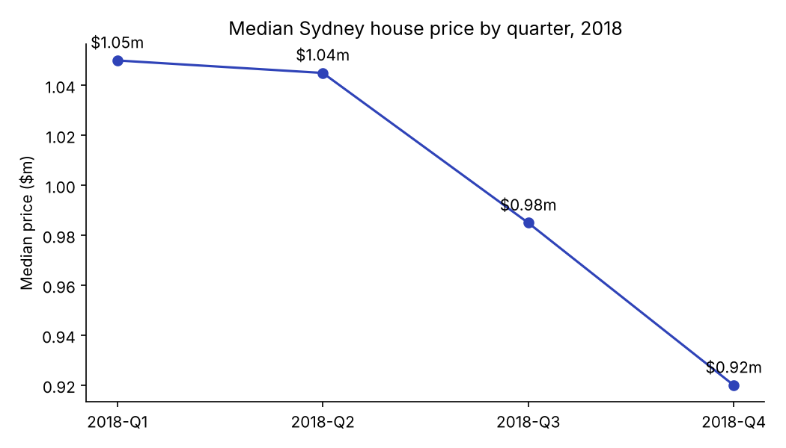
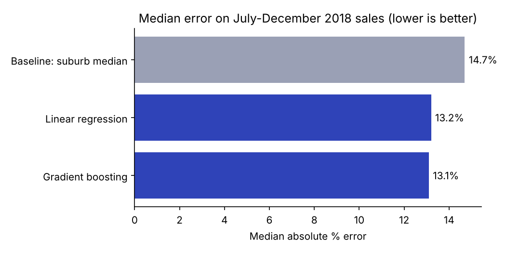
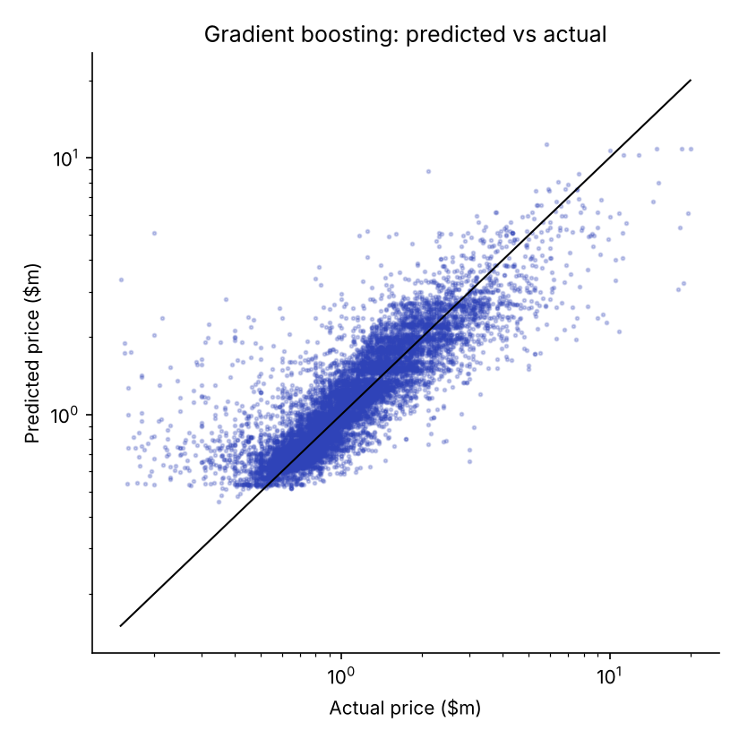

# Sydney House Price Model, 2018

How well can a house's sale price be predicted from its suburb, land size and zoning? This project cleans 210,551 NSW Valuer General sale records down to 37,910 arm's-length Sydney house sales, explores them with SQL, and tests three price models on sales made after the training period.

## Key findings

1. **Sydney prices fell through 2018.** The median house sold for $1,050,000 in January–March and $920,000 in October–December, a 12% drop in nine months.
2. **Location is most of the price.** Land in Millers Point and Paddington averaged $41,779 and $19,101 per square metre; in the Blue Mountains and the Wollondilly fringe (Silverdale, Bargo, Faulconbridge) it was about $600–$760.
3. **Zoning changes what land is worth.** General Residential land averaged $6,263 per square metre against $2,631 for Low Density Residential, likely because denser zones sit closer to the city and allow more to be built.
4. **The models beat the simple baseline, but not by much.** Guessing each suburb's median price was out by 14.7% on a typical sale. Linear regression cut that to 13.2% and gradient boosting to 13.1%, with 40% of sales predicted within 10%. Suburb, land size and zoning alone cannot see bedrooms, condition or views.
5. **A falling market fools models trained on the past.** Trained on sales contracted before July 2018, the gradient boosting model over-predicted July–December prices by 4% on a typical sale and the suburb baseline by 6%. Linear regression, which can extend a time trend, was off by only 1.4%.







## How it works

| Step | File | What it does |
|---|---|---|
| 1. Clean | `src/build_dataset.py` | Keeps whole-property, arm's-length house sales in Greater Sydney postcodes, contracted in 2017–2018, with a plausible price ($150k–$20m) and land size (100–5,000 m²). Drops units, strata lots, part shares, coded (non-market) sales and duplicates. Writes `data/sales.csv`. |
| 2. Analyse with SQL | `sql/*.sql`, `src/run_sql.py` | Loads the sales into SQLite and answers three questions: median price by quarter, most and least expensive suburbs, and price by zoning. |
| 3. Model | `src/model.py` | Trains on contracts before 1 July 2018 and tests on July–December 2018. Compares a suburb-median baseline, linear regression and gradient boosting, predicting log price. |
| 4. Charts | `src/charts.py` | Draws the charts in `charts/`. |
| 5. Tests | `tests/` | Checks the cleaning rules, the date split and that no test prices leak into the features. |

### Avoiding data leakage

- The suburb price level is learned from training sales only. Suburbs with fewer than 5 training sales fall back to their postcode, then to the Sydney-wide median.
- The test set is later in time than the training set, the way a valuation model would be used.
- Every model is compared with a simple baseline, the suburb's median price.

### Limits of the data

The file holds sales **settled** in 2018, so contracts signed in 2017 are only partly covered, and those that are tend to be long settlements. The quarterly trend therefore starts in 2018. The data has no bedrooms, bathrooms or building size, which caps how accurate any model can be.

## Run it yourself

```bash
curl -LO https://github.com/HughParsonage/nsw.property.sales/raw/master/tsv/PropertySales2018.tsv
pip install -r requirements.txt
python src/build_dataset.py PropertySales2018.tsv
python src/run_sql.py
python src/model.py
python src/charts.py
python -m pytest tests
```

## Data

NSW Valuer General Property Sales Information, 2018 settlements (CC BY 4.0), as packaged in the [nsw.property.sales](https://github.com/HughParsonage/nsw.property.sales) repository.

## Tools

Python (pandas, NumPy, scikit-learn, Matplotlib), SQL (SQLite), pytest.
